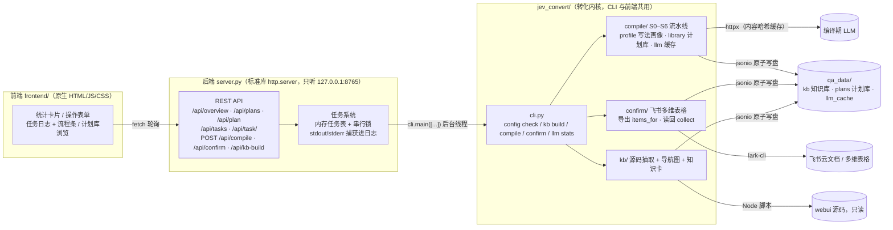

# jev-convert · 测试用例转化

把飞书测试用例思维导图编译成**可执行、可人工确认**的测试计划。是 [jev-qa](https://github.com/zwy123zwy/jev-qa)（浏览器测试 Agent）的「用例转化」独立版：本仓库只做转化，不做执行。

```
飞书思维导图 ──▶ S0 读取 ─▶ S1 写法画像识别 ─▶ S2 步骤规范化 ─▶ S3 页面/元素落地
            ─▶ S4 路线 ─▶ S5 断言 ─▶ S6 静态校验 ─▶ 计划库（qa_data/plans/，入 git）
                                            │
                    draft 待确认项 ──▶ 飞书多维表格（人工确认）──▶ jev-convert confirm 读回
                                            │                        │
                                            └── confirmed 计划 ◀── 别名沉淀进知识库
```

产出的执行计划交给 jev-qa 执行：`jev-qa run --plans qa_data/plans/<导图>`。

## 一、前后端架构

单进程本地应用：Python 后端（编译逻辑 + HTTP 服务）+ 原生 JS 前端，无数据库、无外部服务依赖，所有状态都是 `qa_data/` 下的文件。



- **后端两层**：`server.py` 只做任务编排（提交 → 后台线程跑 `cli.main` → 捕获输出 → 前端轮询），不包含业务逻辑；业务全部在 `jev_convert/` 内核里，CLI 与前端共用同一条代码路径。
- **任务系统**：任务保存在内存（服务重启即消失）；`_RUN_LOCK` 串行执行——编译写计划库、确认写知识库，不允许并发。任务日志里带阶段标记（见下文），前端据此渲染流程条。
- **前端**：Vite + React 18（`frontend/src/components/` 按区块拆组件），`npm run build` 产物由 `server.py` 静态服务；开发模式 `npm run dev` 走代理。任务轮询 1 秒一次，渲染点全部转义。
- **数据可复现**：所有落盘 JSON 键排序、固定缩进、临时文件 + 原子替换，同一输入两次写盘字节一致——计划库和知识库入 git 可评审。

## 二、执行流程

三类任务的阶段划分（日志标记 `▶ 开始` / `✓ 完成` / `- 跳过` / `✗ 失败`，与前端流程条芯片一一对应）：

### 1. 编译 `compile`（CLI：`jev-convert compile <链接> --until sN`）

| 阶段             | 内容                                                                                                                                                                | 产物                                                     |
| ---------------- | ------------------------------------------------------------------------------------------------------------------------------------------------------------------- | -------------------------------------------------------- |
| S0 读取导图      | lark-cli 拉节点树，规范化为 `{id, parent, order, text}`，与上次 diff 得出新增/修改/删除                                                                           | `qa_data/plans/<导图>/source.json`                     |
| S1 识别用例      | 写法画像（候选画像打分取最优）→ 逐节点标角色 → 组成用例草稿；吻合度低于 `profile_fit` 则转人工标注样例、流程到此为止                                            | 画像与草稿（内存）                                       |
| S2-S6 逐用例编译 | 每条用例：规范化 → 页面/元素落地（知识卡候选 + LLM 选择）→ 入口路线 → 断言生成 → 静态校验；置信度 ≥ `auto_confirm` 且无问题 → `confirmed`，否则 `draft` | 计划对象                                                 |
| 计划库写盘       | 按「导图原文 + 知识库版本」增量合并：原文没变保留已确认结果与学到的定位；节点删除 / 知识库重建 → 标 `stale`                                                      | `qa_data/plans/<导图>/<用例 id>.json` + `index.json` |
| 确认表导出       | draft 计划里置信度不足或校验有问题的步骤 + 画像标注样例，按键（用例#步骤#内容哈希）去重后写进多维表格                                                               | 飞书确认表新行                                           |

### 2. 确认读回 `confirm`（CLI：`jev-convert confirm <链接>`）

人在多维表格里对每行填「采纳 / 改为候选 / 手填 / 否决」后运行：

1. **读回确认表**：拉全部行，跳过已处理和别的导图的用例；
2. **更新计划**：按结论改写步骤目标（置信度记 1.0），**重新过一遍 S6**——一条用例所有动作步骤都确认完且无问题才转 `confirmed`，否则留 draft；内容哈希对不上（编译后又变过）的行标「已过期」不动计划；否决的用例整体标 `rejected`；
3. **沉淀与回写**：确认过的「说法 → 元素」写进 `qa_data/kb/confirmed.json`（别名表 + verified 次数，下次编译 S3 直接复用），处理结果回写表格状态。

### 3. 知识库构建 `kb build`（CLI：`jev-convert kb build`）

从 webui 源码抽取 → 解析路由（TypeScript AST）与组件（Vue SFC）→ 合并生成导航图 + 页面知识卡。**重建会覆盖 `kb/` 下的生成文件，但人工沉淀的两个旁路文件不受影响**：`learned.json`（运行学到的起点地标，来自 jev-qa）与 `confirmed.json`（确认表别名），加载时叠加在知识卡之上。

### 前端视角

- 统计卡片：知识库版本、计划库各状态计数、LLM 缓存条目与命中率；
- 提交任务 → 任务日志实时滚动，上方流程条按日志标记点亮芯片；
- 计划库浏览：选导图 → 用例表（状态徽标）→ 点行看步骤详情（类型 / 页面 / 目标 / 置信度 / 断言）。

## 三、启动命令

### 首次安装

```bash
# Python ≥ 3.12 + uv
uv sync
# 知识库抽取脚本依赖 Node
npm install --prefix jev_convert/kb/extract
# 配置
cp qa.example.toml qa.toml        # 填 webui 源码目录、飞书确认表、LLM key
cp .env.example .env              # 密钥只放这里
```

### 启动可视化前端

```bash
# 首次：安装前端依赖并构建
npm install --prefix frontend
npm run build --prefix frontend

uv run python server.py                 # 默认 http://127.0.0.1:8765（服务 frontend/dist）
uv run python server.py --port 9000     # 自定义端口（--host 默认 127.0.0.1，不对外）
```

前端开发模式（热更新，/api 自动代理到 8765）：

```bash
uv run python server.py &               # 先起后端
npm run dev --prefix frontend           # 打开 http://127.0.0.1:5173
```

### CLI（与前端等价）

```bash
uv run jev-convert config check                # 逐项检查配置（密钥只显示已设置/未设置）
uv run jev-convert kb build [--webui <目录>] [--out <目录>]
uv run jev-convert compile <导图链接> [--until s0..s6]
uv run jev-convert confirm <导图链接>
uv run jev-convert llm stats
```

## 四、目录结构

```
jev_convert/
├── cli.py              # CLI 与任务命令编排（阶段标记 ▶✓-✗ 在这里输出）
├── compile/            # S0–S6 流水线（pipeline.py 入口）+ 写法画像 + 计划库 + LLM 缓存
├── confirm/            # 飞书多维表格确认：items_for 导出 / collect 读回 / record_knowledge 沉淀
├── kb/                 # build.py 入口 + extract/（Node 脚本解析 Vue 路由与组件）
├── lark.py             # lark-cli 封装（wiki / mindnote / base 记录读写，错误分类与重试）
├── verify/dsl.py       # 断言 DSL（url / element / text / row / semantic…）
└── config.py  jsonio.py
frontend/               # React 前端（Vite + React 18）：src/components/ 下按页面区块拆组件
server.py               # 本地 HTTP 服务 + 任务系统（服务 frontend/dist 构建产物）
tests/                  # 378 个离线测试（不联网、不调 lark-cli、不启浏览器）
qa_data/                # 入 git：kb/（navgraph、cards、learned.json、confirmed.json）、plans/、llm_cache/
qa_runs/                # 不入 git：llm-stats.json 等运行时产物
```

## 五、配置要点（qa.toml）

| 配置                                                 | 说明                                                                              |
| ---------------------------------------------------- | --------------------------------------------------------------------------------- |
| `[webui].source_dir`                               | 被测前端源码目录（只读），知识库从这里抽取                                        |
| `[compile_llm]`                                    | 编译期 LLM（OpenAI 兼容接口），密钥走 `.env`，`prompt_version` 变更使缓存失效 |
| `[lark].confirm_base_token` / `confirm_table_id` | 确认表的多维表格（表需事先按 `jev_convert/confirm/base.py` 顶部字段清单建好）   |
| `[thresholds].profile_fit` / `auto_confirm`      | 画像吻合度阈值（低于则转人工标注）、自动确认的落地置信度                          |
| `[test_data]`                                      | 固定测试数据，计划里以 `${data.xxx}` 引用                                       |

计划里还有两类引用：`${account.*}`（凭据，只放在 `.env`，由执行侧在动作层替换）、`${<数据名>.<列名>}`（执行侧数据池领取）。

## 六、与 jev-qa 的分工

|          | jev-convert（本仓库）                                 | jev-qa                                         |
| -------- | ----------------------------------------------------- | ---------------------------------------------- |
| 职责     | 导图 → 计划（含人工确认）                            | 计划 → 浏览器执行 → 报告 / 训练数据          |
| 关键产物 | `qa_data/plans/<导图>/<用例>.json`、`qa_data/kb/` | `qa_runs/`（journal、trace、报告）、决策缓存 |
| 技术     | httpx + lark-cli + Node 抽取脚本                      | Playwright + Jev 决策模型                      |

两仓库通过 `qa_data/plans/` 的计划文件衔接，可独立演进。

## 七、开发

```bash
uv run pytest          # 378 个测试，全部离线
uv run ruff check .    # 行宽 120，规则 E/F/I
```

约定：数据文件一律键排序、固定缩进、原子写入；pytest 不访问外部系统；飞书 / LLM 调用全部通过可注入的假对象测试。
